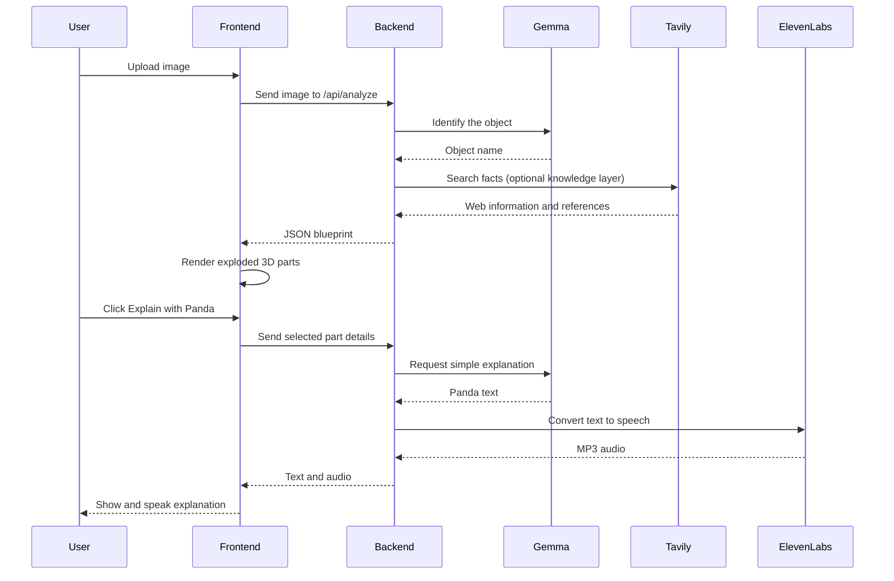

# ✦ Tiny Wonders

### See the tiny parts hiding inside everyday things.

Tiny Wonders is an interactive 3D learning app. Upload a photo—or open the microwave and TV demos—to explore a playful exploded view of the parts inside an object.

🌐 **Website:** [frontend-amber-six-70.vercel.app](https://frontend-amber-six-70.vercel.app/)


## What it does

Tiny Wonders turns an object into a simple visual story:

1. The user uploads an image.
2. Gemma identifies the main object through the Gemini API.
3. The backend creates a validated JSON blueprint of the object and its parts.
4. The frontend converts that blueprint into an interactive exploded 3D view.
5. The user selects a part to see its role, fact, and safety information.
6. **Explain with Panda** sends the selected part to Gemma for a simple explanation.
7. ElevenLabs turns Panda’s explanation into speech and plays it in the browser.

> The current MVP uses Gemma for fast visual identification and local, validated blueprints for reliable rendering. Tavily research can be added as the knowledge-enrichment layer for deeper, up-to-date part information.

## Architecture

```text
Image upload
    ↓
FastAPI backend
    ↓
Gemma vision model via Gemini API
    ↓
Object identification
    ↓
Validated JSON blueprint
    ↓
React + Three.js exploded 3D viewer
    ↓
Selected part → Gemma explanation → ElevenLabs speech
```

### The JSON blueprint

The backend does not send arbitrary model output directly to the 3D scene. It validates a structured blueprint first. The blueprint contains:

- Object name and category
- Confidence score
- Summary and safety note
- Parts, shapes, sizes, colors, and positions
- Connections between parts
- Learning text such as hover descriptions and fun facts

This makes the 3D renderer predictable and prevents malformed AI responses from breaking the interface.

## Technologies

| Area | Technology | Purpose |
| --- | --- | --- |
| Frontend | React, TypeScript, Vite | User interface and application state |
| 3D | Three.js, React Three Fiber, Drei | Interactive exploded object viewer |
| Backend | Python, FastAPI, Uvicorn | API and AI orchestration |
| Validation | Pydantic | Validates blueprint JSON |
| Vision AI | Google Gemma through Gemini API | Identifies uploaded objects and explains parts |
| Web research | Tavily API | Optional research layer for current web information |
| Voice | ElevenLabs Text-to-Speech | Speaks Panda’s explanations |
| Storage | SQLite cache | Stores generated blueprints for reuse |

## Environment variables

Create `backend/.env` from `backend/.env.example`:

```env
# Google Gemini API key used to access Gemma
GEMINI_API_KEY=your_gemini_key

# Vision model used by the backend
GEMMA_MODEL=gemma-4-26b-a4b-it
GEMMA_ATTEMPT_TIMEOUT_SECONDS=45

# ElevenLabs voice generation for Panda
ELEVENLABS_API_KEY=your_elevenlabs_key
ELEVENLABS_VOICE_ID=pNInz6obpgDQGcFmaJgB

# Frontend and upload settings
FRONTEND_ORIGIN=http://localhost:5173
MAX_UPLOAD_MB=8
```

### API key responsibilities

| Key | Used for |
| --- | --- |
| `GEMINI_API_KEY` | Calls Gemma for image identification and Panda explanations |
| `ELEVENLABS_API_KEY` | Converts Panda’s text explanation into spoken MP3 audio |
| `TAVILY_API_KEY` | Intended for web research and fact enrichment when the Tavily layer is enabled |

API keys belong only in the backend `.env`. They must not be placed in frontend environment variables or committed to Git.

## Local setup

### 1. Start the backend

```powershell
cd backend
python -m venv .venv
.\.venv\Scripts\Activate.ps1
pip install -r requirements.txt
Copy-Item .env.example .env
python -m uvicorn app.main:app --reload --host 127.0.0.1 --port 8001
```

Backend health check:

```text
http://127.0.0.1:8001/api/health
```

### 2. Start the frontend

Open another terminal:

```powershell
cd frontend
npm install
npm run dev
```

Open the Vite URL, normally:

```text
http://localhost:5173
```

## Main API routes

| Route | Purpose |
| --- | --- |
| `GET /api/health` | Checks backend and model configuration |
| `GET /api/blueprint/{slug}` | Loads the microwave or TV demo blueprint |
| `POST /api/analyze` | Accepts an uploaded image and returns a blueprint |
| `POST /api/explain` | Gets a Gemma explanation and optional ElevenLabs audio |

## Safety and fallback behavior

Tiny Wonders is an educational visualization, not a repair guide. Electrical devices should not be opened at home.

If Gemma or ElevenLabs is unavailable, the backend logs the problem and the app can still use local demo blueprints or show the text explanation without audio.

## Current MVP scope

- Microwave and TV interactive demos
- Image upload and object identification
- Structured JSON-to-3D rendering
- Part-level Panda explanations
- ElevenLabs spoken responses
- Debug checkpoints in the backend terminal

The next knowledge-layer improvement is connecting Tavily research to the analysis pipeline so model explanations can be enriched with fresh web references before the final blueprint is created.

## How the system works

```mermaid
flowchart LR
    U[User uploads image] --> F[React frontend]
    F --> A[POST /api/analyze]
    A --> G[Gemma vision model]
    G --> I[Object identification]
    I --> J[Validated JSON blueprint]
    J --> V[Three.js 3D renderer]
    V --> P[User selects a part]
    P --> E[POST /api/explain]
    E --> X[Gemma creates simple explanation]
    X --> T[ElevenLabs Text-to-Speech]
    T --> S[Spoken Panda response]

    I -. optional research .-> TV[Tavily web search]
    TV -. facts and references .-> J
```



## Request and response flow


